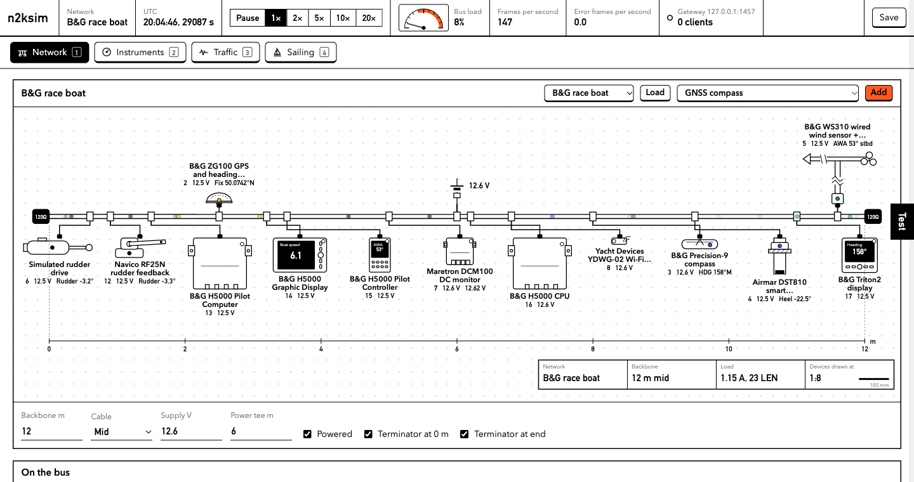

# n2ksim

A simulated NMEA 2000 network you can build, watch and break, in your browser.

n2ksim runs a sailing boat, a set of marine instruments on a simulated CAN bus, and a TCP gateway that real software can connect to. It was built to develop and test a race-yacht autopilot without a boat: the autopilot reads the same frames it would read at sea, and the simulator can put faults on the bus that are hard to arrange on the water.

**Try it:** https://n2ksim-production.up.railway.app (each visitor gets their own simulation)



## What it does

- **A real protocol, simulated.** Devices claim and defend addresses, answer ISO requests, send heartbeats and fast-packet messages, and compete for the bus by priority. Frames are timed to the bit at 250 kbit/s, including stuff bits, so bus load is measured rather than estimated.
- **Real instruments.** A library of 29 products from B&G, NKE, Raymarine, Airmar, Furuno, Garmin and others, each with its documented PGNs, rates, LEN and dimensions, and the source of every figure. Ready-made B&G, NKE and Raymarine boat networks are built from it.
- **A live schematic.** The backbone, tees, terminators and power, with each device drawn to scale from its maker's dimensions. Drag devices to move their tee. Data pulses travel along the cable in the colour of what they carry.
- **Faults and findings.** Pull a terminator, stick a wind sensor, flood the bus, brown out the masthead, force an address conflict. The Test drawer explains what an analyser would see and why, and says whether the evidence comes from the bus, the wiring or only the simulator.
- **Bus against truth.** The Instruments tab decodes everything from frames, as a display would, next to what the boat is really doing.
- **Capture and replay.** Download a capture as candump or Yacht Devices RAW (both open in canboat's `analyzer`), or replay your own logs onto the bus.

## Run it

You need Rust (stable).

```
cargo run --release -p n2ksim
```

Then open http://127.0.0.1:8090. The gateway listens on `tcp://127.0.0.1:1457`.

Options: `--port 8090`, `--bind 127.0.0.1`, `--gateway 127.0.0.1:1457` (or `off`), `--config config/network.json` (loaded at start, written by Save), `--speed 5`, `--hosted` (see below).

Keys: 1 to 4 switch tabs, T opens Test, P pauses.

## The page

- **Network**: the schematic, the backbone settings, an inspector for the selected device (address, NAME, PGNs and rates, faults, error counters, and its library details with sources), the bus as an analyser sees it, and the instrument library.
- **Instruments**: heading, wind, speed, depth, rudder, position and more, decoded from the bus, with a source picker on each, a track, and a table of bus against truth.
- **Traffic**: bus load and frame rate, every PGN by source, a live log of decoded messages or raw frames, sending any frame, capture and replay. The colour key above the log filters by kind of data.
- **Sailing**: wind, gusts, waves, tidal stream, seabed and steering: a manual tiller, a built-in course holder, or an external autopilot.
- **Test** (the tab on the right edge): findings and drills.

## Connect your own software

The gateway speaks the Yacht Devices RAW text format, so anything written for a YDWG-02 or YDEN-02 set to RAW works unchanged. Frames arrive as:

```
10:00:01.234 R 09FD0205 03 4C 06 1B 21 FA FF FF
```

A client sends a frame by writing its identifier and bytes, and gets it echoed back with `T`:

```
09F10D32 00 F8 69 03 FF 7F FF FF
```

That line is PGN 127245 from address 50 with a rudder angle order of +5°. With steering set to Autopilot, the simulated rudder drive follows angle orders for instance 0, moves at 6°/s, and holds its last order and raises a finding if none arrives for a second.

`crates/n2k/examples/ydraw_pilot.rs` is a small working client: it claims an address, asks the other devices to announce themselves, takes heading from a source chosen by NAME, and steers to a course.

```
cargo run --release -p n2ksim
cargo run -p n2k --example ydraw_pilot -- 127.0.0.1:1457 160
```

On a real gateway, one of its servers has to be switched to RAW; Yacht Devices' factory default is NMEA 0183 on TCP 1456. Port 1457 here is n2ksim's own choice.

Software in the same process can be a node of its own instead, as a computer on the backbone through a CAN interface would be. Add a device of kind `node` to the network, then `sim.node_send(id, frame)` puts a frame in its transmit queue and `sim.node_recv(id)` returns every frame it has heard, with the time each ended on the wire. n2ksim models the node's transceiver (power, arbitration, errors, bus off) and nothing else: the software claims its own address, answers requests and sends its own heartbeat. Frames not collected are kept up to 4096, then the oldest are lost.

## Use the codec

`crates/n2k` is a dependency-free NMEA 2000 codec you can use on its own: CAN identifiers, ISO NAME, fast packet, field definitions with generic encode and decode for 33 PGNs, and Yacht Devices RAW and candump log lines.

```rust
use n2k::{decode, pgn, Builder};

let data = Builder::new(pgn::WIND).num("windSpeed", 7.2).num("windAngle", 0.6).lookup("reference", 2).encode();
let m = decode(pgn::WIND, &data);
assert_eq!(m.lookup("reference"), Some(2));
```

## Bring your own boat

The built-in boat is simple on purpose. If you have a better model, plug it in and the instruments measure your boat instead: implement `world::Physics` (step by `dt`, write the boat's `State`: position, heading and rates, heel and pitch, heave, speed and leeway, ground track, true and apparent wind at the masthead, rudder) and build the simulation with `Sim::with_physics`. The seabed, temperatures, pressure, magnetic variation and the clock stay n2ksim's. `world.physics_as_mut::<YourBoat>()` gets your model back to steer it or read its truth.

If your physics names an owner (`Physics::owner`), the page shows the wind, sea and steering as set by that program, read only. To serve the page as part of your own app, build the context with `Ctx::mounted`, read each request with `server::read_head`, and pass those under your prefix to `server::answer` with the prefix taken off. The page's paths are relative, so any prefix works, as long as it ends in a slash. `cargo run --release -p n2ksim --example mounted` shows it working at `http://127.0.0.1:8095/network/`.

## Instruments, networks and drills

The library lives in `crates/n2ksim/library/instruments.json`. A library device sends whichever of the real unit's PGNs the simulator can generate, at the documented interval or canboat's usual one; PGNs it cannot generate yet (mostly proprietary ones, AIS and satellites in view) are listed, not sent. Anything the documentation does not give is left out and listed under gaps and conflicts, never guessed.

Some of what the research found:

- NKE's sensors, processors and pilots are on its own Topline bus; the Box N2K is the only NMEA 2000 node.
- B&G publishes no PGN lists for the H5000 units or the Nemesis, so they send only network management here.
- The B&G WS310 and WS320 masthead units reach NMEA 2000 through an interface box.
- Furuno's SCX-20 manual gives the default rate of every PGN it sends.

**Load network** switches between the generic boat and the B&G, NKE and Raymarine boats. The drills in the Test drawer each break one thing: a missing terminator, an address conflict, a stuck or noisy wind sensor, a GNSS with no fix or hung, a babbling device, low voltage, a heading offset, slow wind data, a loose connector, a faulty transceiver. `cargo run --release -p n2ksim --example drills` runs each for 30 seconds and prints what the checks find.

## Host it

`--hosted` (or `N2KSIM_HOSTED=1`) runs it as a public demo. It listens on `0.0.0.0:$PORT`, gives each visitor their own simulation (kept by a cookie, cleared after 30 minutes idle, at most 25 at once), turns the gateway off, and offers Download instead of saving to disk. Changes are accepted only from the site's own pages, uploads are limited to 4 MB, and if `N2KSIM_PASSWORD` is set the page asks for it (any user name).

The `Dockerfile` builds that. On Railway:

```
railway init --name n2ksim
railway add --service n2ksim
railway up --service n2ksim --ci
railway domain --service n2ksim
railway variables --service n2ksim --set N2KSIM_PASSWORD=...   # optional
```

## Where the numbers come from

- **PGN layouts**: canboat v9.1.0 `docs/canboat.json`, transcribed in November 2026, including resolutions and usual intervals. Fast-packet fill bytes of 0xFF are common practice; canboat does not state them.
- **Manufacturer, class and function codes**: canboat's lookup tables.
- **Instruments**: each library entry lists its sources, mostly the makers' installation manuals and datasheets, often dealer-hosted copies. Figures that are inferred rather than read are marked.
- **Physical layer**: drops at most 6 m each and 78 m in total, 1 LEN is 50 mA, devices run on 9 to 16 V (Garmin's NMEA 2000 network guide); backbone limits of 100 m for Micro and 250 m for Mid and Heavy, and current limits of 3, 4 and 8 A (Actisense, *Complete Guide to NMEA 2000*, revision 4, 2021).
- **Cable resistance**: no manufacturer figure was found, so voltage drop uses copper wire-gauge values for 22, 18 and 15 AWG. Voltages are approximate.
- **Illustrative only**: the boat model and its polar, sensor noise and lag, the error rates caused by missing terminators and long backbones, the 40% bus-load rule of thumb, and the shapes and sizes of generic devices.

## What it does not do

- The boat is a simple model (first-order yaw, surge towards a placeholder polar, roll as a damped oscillator, waves as three sinusoids). It makes believable, coupled data for the bus; it is not a tool for judging steering performance. Plug in your own model for that (see Bring your own boat).
- No ISO transport protocol (60160, 60416), no group function (126208) handling, and no proprietary PGNs beyond a babbling device's junk frames.
- One backbone with one power tee. No NMEA 0183, SignalK, SocketCAN or USB-CAN adapters yet.
- Error frames are a probability per frame, not a signal-level simulation.
- Actisense binary logs are not read; convert them with canboat first.

## Contributing

Issues and pull requests are welcome, especially corrections to the instrument library from people with the kit or its documentation.

- Every figure in a library entry needs a source with a URL. Leave out what you cannot find and list it under `gaps`. The tests reject an entry without sources.
- A new fault or drill needs a check that finds it; a test fails if a drill raises nothing.
- Run `cargo test --release` and `cargo clippy --release --all-targets` before sending changes.

## Licence

Licensed under either of the [Apache Licence, Version 2.0](LICENSE-APACHE) or the [MIT licence](LICENSE-MIT), at your option. Unless you say otherwise, any contribution you submit for inclusion is dual licensed in the same way, without further terms.

## Acknowledgements

The PGN definitions and lookup tables are transcribed from [canboat](https://github.com/canboat/canboat), which is licensed under the Apache Licence 2.0. Product and company names are trademarks of their owners; n2ksim is not affiliated with or endorsed by any of them.
